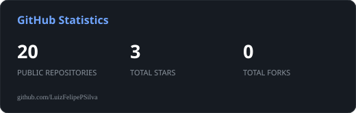
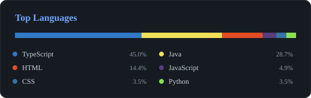

# Luiz Felipe Silva

<p align="center">
  
</p>

<p align="center">
  <a href="https://github.com/LuizFelipePSilva">
    
  </a>
  <a href="https://www.linkedin.com/in/luizfelipepsilva">
    
  </a>
  <a href="mailto:Luizfelipep.s@outlook.com.br">
    
  </a>
</p>

<p align="center">
  <i>"Turning complex problems into elegant, scalable systems."</i>
</p>

---

## `> whoami`

```yaml
name: Luiz Felipe Silva
role: Full Stack Software Engineer
location: Mossoró, RN - Brazil
education: Computer Science @ UFERSA

specialties:
  - Backend Engineering
  - Distributed Systems
  - Cloud Infrastructure
  - AI-powered Applications
  - Real-time IoT Systems

currently_exploring:
  - LLM Agents & RAG
  - System Design
  - Distributed Architecture
  - Application Security

mindset: "Build things that scale. Keep things clean."
```

I'm a software engineer focused on designing and building scalable, reliable software systems.

My experience combines backend engineering, distributed architectures, cloud infrastructure, and modern frontend development.

I enjoy turning complex business requirements into maintainable solutions, optimizing performance, and exploring how AI can solve real-world problems.

---

## `> experience --list`

### `01` — Full Stack Developer

**Alphabet Sphere LDA · Portugal (Remote)**

`Oct 2025 — Oct 2026`

- Designed backend architecture for an IoT aquaculture monitoring platform, integrating physical stations through MQTT.
- Reduced deployment time from **3 minutes to 1.2 minutes** through migration automation and state verification.
- Reduced application startup time from **2,000ms to 200ms** by eliminating redundant production processes.
- Implemented sensor-specific anomaly detection and AI agents with RAG for production data queries.
- Automated operational reports and personalized email notifications based on sensor anomalies.
- Developed modular real-time monitoring interfaces using React and Vite.

`TypeScript` `NestJS` `React` `Vite` `PostgreSQL` `MQTT` `Docker` `AWS` `OpenAI API`

### `02` — Founder & Software Engineer

**SaborSync · Brazil (Remote)**

`Jan 2025 — Sep 2025`

- Conceived and developed a multi-tenant SaaS platform for restaurant and food service management.
- Reduced critical query response time from **900ms to 129ms** using Redis distributed caching.
- Implemented asynchronous notification and email processing with RabbitMQ and MongoDB.
- Designed cloud infrastructure and automated CI/CD pipelines.
- Developed AI-powered customer support agents.
- Built Angular interfaces for multi-tenant administration.
- Achieved **90% unit test coverage**, alongside integration and E2E testing.
- Owned technical decisions, product evolution, and production maintenance.

`TypeScript` `NestJS` `Angular` `PostgreSQL` `Redis` `RabbitMQ` `MongoDB` `Docker` `Jest`

### `03` — Backend Engineering Intern

**Compass UOL · Brazil (Remote)**

`Aug 2024 — Jan 2025`

- Developed 3 REST APIs for enterprise systems, integrating previously disconnected workflows.
- Automated build, testing, and deployment through AWS-integrated CI/CD pipelines.
- Implemented containerized development environments with relational databases.
- Led a team of 5 developers building a dealership management system.

`Node.js` `TypeScript` `PostgreSQL` `MySQL` `Docker` `AWS EC2` `GitHub Actions` `Jest`

---

## `> ls ./featured-projects`

<table>
<tr>
<td width="50%" valign="top">

### 🍽️ SaborSync

**Multi-tenant SaaS Platform**

A management platform designed for restaurants, bars, and cafés.

**Engineering highlights**

- Multi-tenant architecture
- Clean Architecture & DDD
- Redis distributed caching
- Asynchronous processing
- AI-powered support agents

**Stack**

`NestJS` `Angular` `PostgreSQL` `Redis` `RabbitMQ` `AWS`

</td>
<td width="50%" valign="top">

### 🐟 Aquaculture IoT Platform

**Real-time Monitoring & AI**

An IoT platform for monitoring aquaculture production and environmental conditions.

**Engineering highlights**

- MQTT sensor ingestion
- Real-time anomaly detection
- AI agents with RAG
- Automated operational reports
- Sensor data visualization

**Stack**

`NestJS` `React` `PostgreSQL` `MQTT` `Docker` `AWS` `OpenAI`

</td>
</tr>
</table>

---

## `> cat tech-stack.json`

**Backend & Languages**

<p>
  
</p>

**Frontend**

<p>
  
</p>

**Databases & Messaging**

<p>
  
</p>

**Cloud & DevOps**

<p>
  
</p>

**AI & Architecture**

`OpenAI API` `LLM Agents` `RAG` `Function Calling` `Prompt Injection Security` `Clean Architecture` `DDD` `Microservices` `CI/CD`

---

## `> ./github-stats.sh`

<p align="center">
  
  
</p>
---

## `> cat education.log`

**Federal Rural University of the Semi-Arid Region (UFERSA)**

Bachelor's Degree in Computer Science

`May 2024 — Dec 2027 (In Progress)`

**Certification**

- AWS Certified Cloud Practitioner — CLF-C02 (Feb 2025)

**Languages**

- Portuguese — Native
- English — Intermediate

---

## `> establish_connection`

<p align="center">
  <a href="mailto:Luizfelipep.s@outlook.com.br">
    
  </a>
  <a href="https://www.linkedin.com/in/luizfelipepsilva">
    
  </a>
  <a href="https://github.com/LuizFelipePSilva">
    
  </a>
</p>

<p align="center">
  <sub>EOF · Thanks for visiting my profile.</sub>
</p>
